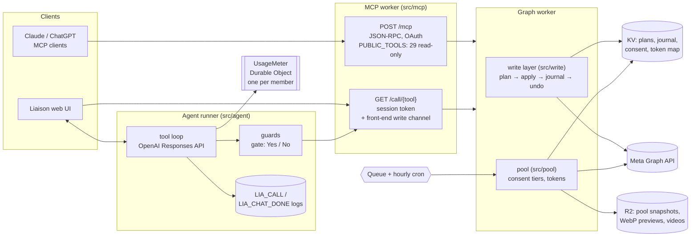

# Liaison Agents Backend (Cloudflare)

Server-side code from **Liaison** ([liaisone.com](https://liaisone.com)), an agentic OS for Meta Ads:
the operator says what they want in plain language, an AI agent reads the ad account and prepares the
change, and the change reaches Meta only after the person explicitly confirms it. Every write is
journalled and can be undone, and every object the agent creates starts out PAUSED.

> **This is a curated extract, not the full production codebase.** Each file below was taken from the
> production workers and minimally adapted: imports and exports stitched together, unrelated branches
> trimmed, internal comments cleaned up. Each file's header comment says what was trimmed. It is meant to
> be read and tested. It does not deploy as-is (see [What is not here](#what-is-not-here)).

## Architecture



Data fetching from MCP clients and from the UI goes through the MCP worker, which proxies every call to the
Graph worker with a shared internal token. The tenant is always resolved on the server from a verified
token. A member id sent by a client is never trusted.

## The five areas

### 1. MCP server for Claude and ChatGPT: `src/mcp/`

- `tools.js` has 33 tools, each with a JSON Schema and MCP annotations (`title`, `readOnlyHint`,
  `destructiveHint`, `openWorldHint`). The title is the name the connector directories show.
- `PUBLIC_TOOLS` filters out every `plan_*` / `apply_*` tool, which leaves **29 read-only tools** for
  external clients. An outside model can read an account but cannot prepare or apply a change, and this is
  enforced in code, not by the prompt. A plan tool called by name gets the same "Unknown tool" answer as a
  tool that does not exist.
- `server.js` serves two surfaces over the same `executeTool`:
  - **JSON-RPC** at `POST /mcp` (streamable HTTP, stateless). A request with no bearer token gets a 401 with
    `resource_metadata`, which starts OAuth in the client. Discovery follows RFC 8414 and RFC 9728, with
    dynamic client registration (RFC 7591) and PKCE S256 for public clients.
  - **REST** at `GET /call/{tool}`, used by the product UI. It is authenticated by a session token with a
    sliding 15-minute TTL. The UI's write channel (`apply_write_plan`, `undo_write`, the journal) is a fixed
    allow-list (`BW_FRONT`) that is deliberately absent from `TOOLS`, so no model ever lists it.
- A failed call returns `isError` with a `meta_error` marker. A failure must never reach the user as
  "zero spend" or "everything is paused".

### 2. The write path: plan, explicit confirm, apply, journal, undo: `src/write/`

| Step | File | What it guarantees |
|---|---|---|
| plan | `plan.js` | Reads the current values from Meta and builds the diff, the fields to send and the undo record. Stores `lia:plan:{uuid}`. **Nothing is sent to Meta.** |
| confirm | `src/agent/gate.js` + UI | The person answers Yes / No above the input. The model never applies anything. |
| apply | `apply.js` | Member check, then **staleness check, then consume the plan, then the Graph write**, in that order. Consuming first closes the double-click window in practice; KV has no compare-and-set, so a strict once-only guarantee would need a Durable Object per plan. A refused write puts back the plan exactly as it was read. |
| journal | `journal.js` | One row per write that reached Meta (diff + undo + plan id + chat + account). |
| undo | `undo.js` | Undo is a **second write**: a reverse plan that is confirmed, staleness-checked and journalled like any other. It is refused if the row was already undone, was superseded, the object was changed outside Liaison, or the object no longer exists. |

- **Born PAUSED.** Copies use `status_option=PAUSED`, created ads use `status=PAUSED`, and a plain
  update may only *pause*. Turning something **on** is a separate `activate_entity` plan. That plan reads
  the paused parent chain, says what else would start spending and how much a day, and gets its own
  confirmation. The only exception is undoing our own pause. It is unlocked by an `undo_of` marker that only
  the undo route can set (a per-isolate secret header, checked in `router.js`).
- **No timer, staleness instead (`stale.js`).** A plan waits for the person for as long as it is stored, and
  is cancelled for one reason only: the object it changes moved in Meta since the plan was made. Apply
  re-reads exactly the fields the plan touches and compares them with the recorded "before" values. The
  values are canonicalised so that the same state in a different shape still compares equal. Meta's activity
  feed and webhooks mark open plans on a changed object as *suspects* (`lia:planstale:{plan}`), and the next
  read verifies them. A cancelled plan keeps its reason, so pressing Yes again explains why instead of
  saying "expired".
- **validate_only.** In production, the creation planners (not included here) send the whole create request
  to Meta with `execution_options=["validate_only"]` at *plan* time. A plan the person sees has already been
  accepted by Meta, and nothing was created.

### 3. Per-tool-call logs: `src/agent/`, `tools/`

- `call-log.js` writes **one `LIA_CALL` line per tool call**, whatever path the call took. Each line has a
  `kind`: `ran`, `not_run`, `not_offered`, `refused_guard`, `refused_duplicate`, `refused_unknown_id` or
  `refused_program`. It also has the tool, `ok`, `ms`, the first 200 characters of the error, the model and
  the mode, plus `caller`, `door` and `gate` for a call that ran. It never holds arguments or personal data.
  `LIA_CHAT_DONE` is one line per turn: latency split, tokens (including cached and reasoning), hops, writes
  and the reason the turn stopped (`gate:<tool>`, `ask:<field>`).
- `guards.js` holds the runner checks those kinds come from. Production order:
  - one change per step: other calls wait for the Yes / No
  - the exact repeat and the per-turn cap (8)
  - "a tool this turn did not offer"
  - the namesake gate (an id whose name matches several objects)
  - the unknown-id gate (an id no tool returned in this chat)
- `gate.js`: what the person *pressed* comes from the browser, and what *happened* comes from the write
  layer. A pasted "[gate_reply] yes" cannot make the agent believe in an object that does not exist.
- `tools/calls.sh` reads `LIA_CALL` lines back through the Workers Observability API (`tools/logs.sh`) and
  prints each tool's calls, failures, refusals, waits and median latency, or one chat call by call
  (`tools/calls.py`).

### 4. A Durable Object as the single writer: `src/usage/`

`UsageMeter` is **one Durable Object per member** (`idFromName(member)`) and the only writer of that
member's spend in three windows: a rolling session, a 7-day cycle anchored at 05:00 UTC, and the calendar
month. It replaced KV read-modify-write, which lost concurrent increments. The pattern:

- **Single writer.** A DO runs one call at a time for an id. Each charge is one read-apply-write, and
  `reserve` checks and holds in the same call, so two batch jobs cannot both see the whole balance.
- **Storage.** One value in the object's transactional storage. On first use the object seeds itself from
  the old KV keys, so nothing counted before the migration is lost.
- **Mirror.** After each write the windows are copied back to the KV keys the old readers use. KV becomes a
  read cache and the object is the record.
- **Idempotency.** A booking that carries the provider's call id lands once, so a retry after a thrown RPC is
  safe.
- **No alarm needed.** Windows roll lazily on every call, and holds carry their own expiry. (Elsewhere the
  codebase uses DO alarms for garbage collection, with an "earliest alarm wins" `setAlarm` pattern. That is
  not included here.)

### 5. The anonymized cross-tenant pool: `src/pool/`

Advertisers can see where other advertisers' creatives run on a map without seeing who they are.

- **Consent tiers 0-3** (`global:consent:{member}`):
  - 0: out
  - 1: anonymous geo dot (coordinates coarsened to about 1.1 km unless the owner chose "exact")
  - 2: adds the creative preview and format
  - 3: adds CPL, CTR and CPM, as **ratios only**. Never spend, lead counts or names.
  The server enforces the owner's stored tier whatever a caller submits.
- **Reciprocity.** The effective tier per owner is `min(owner.tier, requester.tier)`. Tier 0 sees nothing,
  and a member must share **at least one** ad account to see anything.
- **Opaque tokens.** `tok` is the first 24 base64url characters of
  `HMAC-SHA256(secret, owner|item|kind|epochDay)`: unguessable, irreversible, stable for a UTC day and
  **rotated daily**. The reverse map `gtok:{tok}` stays on the server for 2 days. Raw ad, video and member
  ids never leave the server. Viewers get `…/asset?tok=` and `…/video?tok=` proxy URLs only, built from an
  explicit field allow-list.
- **Media.**
  - Previews are **eager**: on publish they are transcoded to WebP through Cloudflare Images when that is
    smaller, stored in R2, checked with `head` first so they are never fetched twice, about 50 new fetches
    per publish, 3 at a time.
  - Videos are **lazy**: the first viewer triggers a fetch with the owner's page token on the server, which is
    then persisted to R2 and served Range-aware. Simultaneous requests share one fetch, and each owner is
    capped at 6 concurrent fetches.
  - The asset proxy re-checks the owner's *current* tier, so opting out takes effect immediately.
- **Build.**
  - A producer fans out one queue message per ad account (`max_batch_size = 1`, retries, dead-letter queue).
  - The hourly cron runs the full refresh at 03:00 UTC only, capped at 200 members per run.
  - Per-owner and aggregate snapshots in R2 are merged with **etag compare-and-set**, because the queue
    consumers run in parallel.

## Stack

Cloudflare Workers (plain ES modules, no build step) · KV · R2 · Durable Objects · Queues · Cron Triggers ·
Cloudflare Images · MCP (JSON-RPC 2.0 over streamable HTTP, OAuth 2.0 + PKCE) · Meta Marketing API (Graph
v26.0, batch requests, `validate_only`) · OpenAI Responses API tool loop (the runner itself is not included;
its guards, gate and logs are).

## Naming

- `bw*` / `BW_*`: the write layer (the product's "browser write" API, which the in-app Ads Manager and the agent share).
- `lia:*`: KV keys. `LIA_*`: structured log events (one JSON line each).
- "door": the surface a call came through (agent chat, in-app editor, MCP). "card": the Yes / No confirm UI.

## Layout

```
src/mcp/      tools.js (33 tools, PUBLIC_TOOLS)  server.js (JSON-RPC + REST + OAuth discovery)
src/write/    plan.js  apply.js  journal.js  undo.js  stale.js  router.js  common.js
src/agent/    guards.js  gate.js  call-log.js
src/usage/    usage-windows.js (pure)  usage-meter.js (Durable Object)
src/pool/     tokens.js  snapshot.js  serve.js  media.js  build.js  meta-reads.js (placeholders)
tools/        calls.sh  calls.py  logs.sh
examples/     wrangler.*.example.toml (placeholder ids only)
test/         run.js (no dependencies) + *.test.js
```

## Running the tests

```
node test/run.js          # Node 20.6+; no npm install needed
node test/run.js pool     # one file
```

There are 181 assertions in 7 files, all runnable offline. KV, R2, Graph and the Durable Object runtime are
in-memory stand-ins (`test/support/`). They cover:

- staleness
- the full plan → apply → journal → undo flow against a simulated Graph API
- the gate and the guards
- the MCP surface
- the meter under 40 concurrent charges
- token rotation, tier cuts and reciprocity
- the media caps

A sample of the guarantees was checked by mutation (removing the guard makes a test fail): the staleness
refusal, consume-before-write, the `undo_of` strip, the public-tool filter, `min()` reciprocity, the video
cap and the idempotent booking.

Not covered: the Workers runtime itself (real KV consistency, DO input gates, queues), the Meta API's
actual behaviour, the agent runner's model loop, and the OAuth authorize/token handlers, which are not
included.

## What is not here

The Graph read layer (insights, ads tree, targeting, creatives), the creation planners (campaign, ad set, ad,
rules, A/B tests), the OAuth and sign-in flows, the agent runner and its prompts, the web and desktop
clients, and every other product worker. `src/pool/meta-reads.js` marks the read layer the pool builder
calls. The Worker entry points that route URLs to these handlers are reduced to `router.js` and the
`poolHandlers` object.
